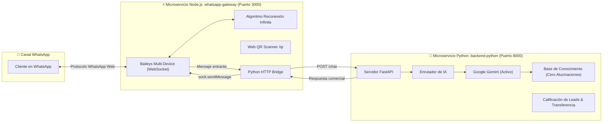

# 🚀 Zenith Code - Asistente Operativo & WhatsApp Gateway In-House

Arquitectura distribuida y de alto rendimiento basada en microservicios contenerizados con **Docker Compose**, diseñada para automatizar WhatsApp de forma **100% gratuita** prescindiendo de intermediarios y proveedores de pago (Meta Cloud API, Twilio, etc.), con inteligencia artificial impulsada por **Google Gemini** (y soporte para OpenAI).

---

## 🏗️ Arquitectura del Sistema



---

## 🌟 Componentes y Aspectos Técnicos

### 1. `whatsapp-gateway` (Node.js + Baileys)
- **Librería Base**: `@whiskeysockets/baileys` interactuando directamente sobre WebSockets nativos de WhatsApp Web (multi-device) sin la sobrecarga de memoria de navegadores embebidos como Puppeteer/Chromium (consumo promedio: **~40 MB RAM**).
- **Algoritmo de Reconexión Infinita (Crítico)**:
  - Evalúa el código de estado del error (`DisconnectReason` de Boom).
  - Tolerancia ante pérdida de cobertura celular, apagado o batería baja del teléfono móvil (`timedOut`, `connectionLost`, `connectionClosed`).
  - **Backoff Exponencial con Jitter**: delay incremental calculado como `base * 1.5^intentos + jitter aleatorio` hasta un tope configurable, evitando saturación del socket.
  - **Manejo de Cierre de Sesión (`loggedOut` / `badSession`)**: Limpia automáticamente los tokens caducados del directorio de autenticación y re-solicita un nuevo código QR sin bucles infinitos de credenciales inválidas.
- **Visualización de Código QR**:
  - En terminal mediante `qrcode-terminal`.
  - En interfaz web visual accesible en `http://localhost:3000/qr` con auto-recarga y estado en vivo.
- **Puente HTTP Bidireccional**: Envía los mensajes entrantes hacia `http://python-backend:8000/chat` y responde al cliente por WhatsApp en tiempo real.

### 2. `backend-python` (FastAPI + Google Gemini)
- **Cero Alucinaciones**: Inyección dinámica del catálogo de servicios, políticas comerciales y preguntas frecuentes.
- **Tono y Lenguaje**: Español salvadoreño natural, profesional y conciso (1 a 3 párrafos cortos).
- **Flujo de Calificación**: Pregunta conversacionalmente una cosa a la vez (tipo de proyecto y tiempo estimado).
- **Protocolo de Transferencia Humana**: Si el usuario pide un humano o se frustra, transfiere de inmediato con el mensaje protocolario.

---

## 📁 Estructura del Proyecto

```text
Zenith Code/
│
├── docker-compose.yml              # Orquestador multi-contenedor
├── .env.example                    # Plantilla de variables de entorno global
├── .gitignore
├── README.md
│
├── backend-python/                 # 🐍 Microservicio Asistente de IA
│   ├── Dockerfile
│   ├── requirements.txt
│   ├── config.py
│   ├── main.py
│   ├── test_app.py
│   ├── demo_cli.py
│   ├── knowledge/                  # Base de conocimiento (catálogos, políticas)
│   └── services/                   # Servicios de IA, Leads y Router
│
└── whatsapp-gateway/               # ⚡ Microservicio WhatsApp In-House
    ├── Dockerfile
    ├── .npmrc
    ├── package.json
    ├── auth_info_baileys/          # Volumen persistente de sesión multi-device
    └── src/
        ├── index.js                # Servidor Express, endpoint /qr y /api/send
        ├── config.js
        ├── bridge/
        │   └── pythonBridge.js     # Enrutador hacia FastAPI
        └── whatsapp/
            ├── reconnection.js     # Tolerancia a fallos y backoff exponencial
            └── session.js          # Ciclo de vida y socket de Baileys
```

---

## 🐳 Despliegue con Docker Compose (Recomendado)

### 1. Configurar variables de entorno
Crea tu archivo `.env` en la raíz del proyecto:
```powershell
Copy-Item .env.example .env
```
Edita `.env` con tu clave de Gemini:
```ini
COMPANY_NAME=Zenith Solutions
AI_PROVIDER=gemini
GEMINI_API_KEY=tu_clave_de_google_gemini_aqui
GEMINI_MODEL=gemini-2.5-flash
```

### 2. Levantar los contenedores
```bash
docker compose up --build
```

### 3. Vincular WhatsApp
1. Abre tu navegador en **`http://localhost:3000/qr`** (o mira la consola del contenedor).
2. Abre WhatsApp en tu teléfono celular > **Dispositivos vinculados** > **Vincular un dispositivo**.
3. Escanea el código QR mostrado en pantalla.
4. ¡Listo! La sesión se mantendrá guardada en el volumen persistente de Docker (`baileys_auth_data`). Si reinicias los contenedores o el servidor, la sesión se reanudará automáticamente sin pedir QR nuevamente.

---

## 💻 Ejecución Local sin Docker (Modo Desarrollo)

### Terminal 1: Iniciar el Backend de Python
```powershell
cd "backend-python"
..\venv\Scripts\python main.py
```
*(Disponible en `http://localhost:8000`)*

### Terminal 2: Iniciar el Gateway de WhatsApp
```powershell
cd "whatsapp-gateway"
npm start
```
*(Disponible en `http://localhost:3000` y QR en `http://localhost:3000/qr`)*

---

## 📡 Endpoints del Sistema

| Servicio | Método | Ruta | Descripción |
|---|---|---|---|
| **WhatsApp Gateway** | `GET` | `/qr` | Interfaz web interactiva para escanear el QR y ver estado |
| **WhatsApp Gateway** | `GET` | `/api/status` | Estado actual de conexión (`CONNECTED`, `WAITING_QR`, etc.) |
| **WhatsApp Gateway** | `GET` | `/api/qr` | Obtiene el QR en formato string y Base64 DataURL |
| **WhatsApp Gateway** | `POST` | `/api/send` | Envío manual de mensajes `{ to: "503...", text: "..." }` |
| **WhatsApp Gateway** | `POST` | `/api/logout` | Desvincula el teléfono y genera un nuevo QR |
| **Python Backend** | `POST` | `/chat` | Motor de inferencia y calificación con IA `{ session_id, message }` |
| **Python Backend** | `GET` | `/sessions` | Monitoreo de prospectos calificados y transferencias |
