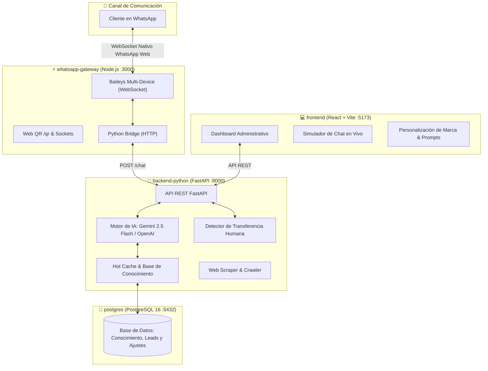

# 🚀 Resumen Completo del Sistema: Zenith Code

**Zenith Code** es una plataforma distribuida de **asistencia operativa, ventas y atención al cliente 24/7** automatizada mediante **WhatsApp**, diseñada para operar de forma **100% gratuita** e **in-house**, eliminando tarifas por mensaje y prescindiendo de intermediarios de pago (Meta Cloud API, Twilio, Z-API, etc.).

El sistema combina la velocidad de **WebSockets nativos**, el razonamiento de **Google Gemini** (con respaldo de **OpenAI**) y una arquitectura moderna de microservicios contenerizada con **Docker Compose**.

---

## 🏗️ Arquitectura de Microservicios



---

## 🌟 Funcionalidad Detallada por Componente

### 1. `whatsapp-gateway` (Node.js + Baileys / Puerto 3000)
- **Conexión Directa sin Navegador Emulado:** Utiliza `@whiskeysockets/baileys` para hablar directamente con los servidores de WhatsApp mediante WebSockets nativos. Su consumo promedio es de apenas **~40 MB RAM**, a diferencia de navegadores headless (Puppeteer / Chromium) que superan los 800 MB.
- **Visualizador Web de QR (`/qr`):** Interfaz interactiva y moderna accesible en `http://localhost:3000/qr` para vincular cualquier número de WhatsApp escaneando el código QR.
- **Algoritmo de Reconexión Infinita con Jitter:** En caso de corte de red, batería baja o reinicio del teléfono, calcula un retraso progresivo con backoff exponencial (`base * 1.5^intentos + jitter`) evitando saturar la conexión.
- **Persistencia de Sesión:** Las credenciales y claves criptográficas se guardan en el volumen Docker `zenith_baileys_auth_data`, evitando tener que volver a escanear el QR tras reinicios.
- **Puente HTTP Bidireccional:** Envía los mensajes entrantes a `http://python-backend:8000/chat` y devuelve la respuesta al chat de WhatsApp en tiempo real.

---

### 2. `backend-python` (FastAPI + Google Gemini / Puerto 8000)
- **Motor de Inferencia con IA:** Emplea **Google Gemini 2.5 Flash** como motor principal de bajo costo, alta velocidad y capacidad analítica.
- **Failover Automático (Tolerancia a Fallos):** Si la API de Gemini presenta intermitencias o cuota agotada, conmuta de forma transparente e instantánea a **OpenAI (`gpt-4o-mini`)**.
- **Cero Alucinaciones (RAG & Hot Cache):** La IA solo responde con datos contrastables del catálogo de servicios, precios y políticas cargados en la base de datos y cargados en memoria.
- **Web Scraper & Crawler Integrado:** Permite ingresar URLs de páginas web corporativas para extraer el contenido limpio (HTML a texto vía BeautifulSoup) e indexarlo automáticamente como conocimiento para el bot.
- **Protocolo de Derivación Humana (Handoff):** Si el cliente solicita explícitamente hablar con un humano o se frustra, la IA cede el control, detiene sus respuestas para esa conversación y notifica al asesor.
- **Reactivación Automática por Inactividad:** Tras un periodo configurable de inactividad (por defecto 6 horas), el asistente retoma la atención si el cliente vuelve a escribir.

---

### 3. `frontend` (React 19 + Vite + Tailwind CSS / Puerto 5173)
- **Dashboard Integral:** Panel administrativo moderno y reactivo accesible en `http://localhost:5173`.
- **Simulador de Chat en Tiempo Real:** Permite a los administradores probar las respuestas del asistente, ajustes y políticas antes de ponerlos a prueba con clientes reales.
- **Gestión de Base de Conocimiento:** Interfaz visual para añadir artículos, documentos de texto o URLs de sitios web para ser scrapeados e indexados.
- **Monitor de Conversaciones y Handoffs:** Vista de todas las conversaciones activas, leads calificados, motivos de derivación a humano, notas internas y etiquetas comerciales.
- **Personalización de Marca en Caliente:** Permite modificar desde la web el nombre de la empresa, tono de voz, instrucciones especiales, mensaje de bienvenida y colores corporativos sin reiniciar contenedores.

---

### 4. `postgres` (PostgreSQL 16 Alpine / Puerto 5432)
- Motor de persistencia para:
  - Documentos de conocimiento y fuentes web indexadas.
  - Ajustes de configuración que sobreescriben variables de entorno en tiempo de ejecución.
  - Registro de sesiones, historial de mensajes y estados de transferencias a humano.
  - *(Respaldo local: Si no se utiliza PostgreSQL, el backend incluye conmutación automática a SQLite local).*

---

## 🔄 Flujo Operativo Completo (Customer Journey)

1. **Mensaje Entrante:** Un cliente envía un mensaje al WhatsApp de la empresa.
2. **Recepción:** El microservicio `whatsapp-gateway` captura el evento mediante el WebSocket de Baileys.
3. **Validación:** Se envía vía HTTP a `backend-python` (`POST /chat`).
4. **Verificación de Handoff:** Si el chat está en manos de un asesor humano, la IA no interviene para no interferir.
5. **Contextualización (RAG):** El sistema inyecta en el prompt los datos de la base de conocimiento relevantes.
6. **Inferencia:** Gemini (o el fallback de OpenAI) redacta la respuesta en lenguaje natural y profesional.
7. **Despacho:** `whatsapp-gateway` envía el mensaje de vuelta al usuario por WhatsApp en milisegundos.

---

## 📡 Tabla de Endpoints y Puertos

| Servicio | Puerto | Ruta / URL | Descripción |
|---|---|---|---|
| **Frontend Web** | `5173` | [http://localhost:5173](http://localhost:5173) | Panel de administración y dashboard interactivo |
| **WhatsApp Gateway** | `3000` | [http://localhost:3000/qr](http://localhost:3000/qr) | Interfaz visual para escanear el código QR |
| **WhatsApp Gateway** | `3000` | `GET /api/status` | Estado de la conexión de WhatsApp |
| **WhatsApp Gateway** | `3000` | `POST /api/send` | Envío manual o programado de mensajes |
| **Backend Python** | `8000` | [http://localhost:8000/docs](http://localhost:8000/docs) | Documentación interactiva Swagger UI |
| **Backend Python** | `8000` | `POST /chat` | Endpoint central de conversación con IA |
| **Backend Python** | `8000` | `GET /api/knowledge` | Listado de documentos y fuentes indexadas |
| **PostgreSQL** | `5432` | `localhost:5432` | Base de datos relacional persistente |

---

## 🛠️ Comandos de Operación

- **Iniciar todos los servicios:**
  ```bash
  docker compose up --build -d
  ```
- **Ver logs en vivo:**
  ```bash
  docker compose logs -f
  ```
- **Ver logs de WhatsApp Gateway:**
  ```bash
  docker compose logs -f whatsapp-gateway
  ```
- **Detener los servicios:**
  ```bash
  docker compose down
  ```
