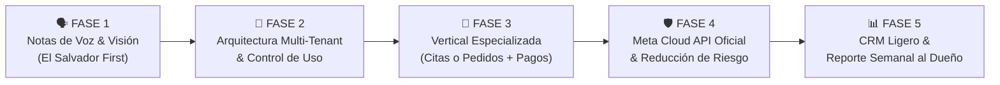

# 📈 Roadmap de Implementación: Zenith Code Rentable (El Salvador)

Este plan de desarrollo traduce el análisis estratégico en tareas técnicas concretas, organizadas en fases incrementales para monetizar Zenith Code rápidamente como una solución B2B recurrente en El Salvador.

---

## 🧭 Fases de Desarrollo

---

## 📋 Lista de Tareas y Estado

### 🗣️ FASE 1: Adaptación Local El Salvador (Notas de Voz, Comprobantes y Voseo)
> **Objetivo:** Resolver la fricción real en El Salvador, donde más del 60% de interacciones comerciales ocurren mediante notas de voz y fotos de transferencias de Banco Agrícola/Cuscatlán/BAC.

- [ ] **1.1 Soporte de Notas de Voz en WhatsApp Gateway**
  - Capturar mensajes tipo `audioMessage` en Baileys.
  - Descargar buffer con `downloadMediaMessage`.
  - Enviar payload de audio (`mimeType: audio/ogg; codecs=opus`, base64) al endpoint `/chat` de FastAPI.
- [ ] **1.2 Procesamiento de Audio Multimodal en FastAPI con Gemini**
  - Recibir audio en `backend-python` e integrarlo en la inferencia multimodal de Gemini 2.5 Flash.
  - Transcribir y responder al cliente con la respuesta comercial adecuada.
- [ ] **1.3 Comprensión de Imágenes y Comprobantes Bancarios (Gemini Vision)**
  - Procesar `imageMessage` (fotos de comprobantes bancarios, transferencias, productos).
  - Validar automáticamente monto, fecha, referencia bancaria y alertar al asesor.
- [ ] **1.4 Prompt y Tono Salvadoreño Natural ("Voseo")**
  - Implementar preset de tono con tratamiento de "vos" profesional, claro, empático y salvadoreño natural.

---

### 🏢 FASE 2: Arquitectura SaaS Multi-Tenant & Seguridad
> **Objetivo:** Permitir gestionar decenas de negocios en una sola infraestructura compartida, cobrando una mensualidad fija por cliente.

- [ ] **2.1 Esquema de Base de Datos Multi-Tenant en PostgreSQL**
  - Tablas: `tenants`, `tenant_users`, `tenant_settings`, `api_usage_metrics`.
  - Clave foránea `tenant_id` en `knowledge_items`, `conversation_handoffs` y sesiones.
- [ ] **2.2 Autenticación JWT y Roles**
  - Roles: `SuperAdmin` (tú), `BusinessOwner` (dueño del negocio) y `Agent` (asesor humano).
- [ ] **2.3 Medición de Tokens y Costos de IA por Cliente**
  - Registro de consumo diario de tokens Gemini/OpenAI para tarificación y límites de plan.
- [ ] **2.4 Aislamiento en el Frontend Dashboard**
  - Selector de empresa activa y control de acceso seguro por negocio.

---

### 📅 FASE 3: Primera Vertical Empaquetada & Pagos
> **Objetivo:** Vender resultados concretos (citas agendadas o pedidos cerrados) y cobrar mensualidades de $99 - $149/mes.

- [ ] **3.1 Motor de Agendamiento de Citas (Clínicas, Dentistas, Estéticas)**
  - Consulta de disponibilidad horaria conversacional.
  - Reserva de citas en PostgreSQL y sincronización con Google Calendar / Cal.com.
  - Recordatorios automáticos de confirmación para reducir ausentismo.
- [ ] **3.2 Generación de Enlaces de Cobro Locales**
  - Soporte de links de pago Wompi (Banco Agrícola) / Tarjetas de crédito/débito.
  - Instrucciones guiadas para pago por transferencia directa (CUSCATLAN, BAC, Agrícola) o Chivo/Lightning.

---

### 🛡️ FASE 4: Canal Dual (Meta Cloud API Oficial + Baileys)
> **Objetivo:** Ofrecer el plan Premium corporativo ($249/mes) sin riesgo de baneo para clientes grandes y mantener Baileys para emprendedores.

- [ ] **4.1 Abstracción de Proveedor de WhatsApp (`ChannelAdapter`)**
  - Interfaz común `send_message`, `receive_message`, `send_template`.
- [ ] **4.2 Driver Oficial de Meta Cloud API**
  - Endpoint de Webhook validado por Meta (`/webhook/meta`).
  - Despacho de mensajes y gestión de ventana de 24 horas.
- [ ] **4.3 Modo Simulación Humana en Baileys**
  - Tiempos de retardo aleatorios (jitter) y límites de mensajes por hora para evitar bloqueos.

---

### 📊 FASE 5: CRM Ligero y Reporte Semanal de Retención
> **Objetivo:** Mostrarle al dueño del negocio el retorno de inversión cada semana para evitar cancelaciones de suscripción.

- [ ] **5.1 Pipeline de Leads en el Frontend**
  - Vista Kanban o lista filtrada: *Contacto Inicial -> En Calificación -> Cita Agendada -> Transferido a Asesor -> Cerrado*.
- [ ] **5.2 Reporte Semanal Automatizado por WhatsApp**
  - Resumen enviado al dueño cada domingo a las 8:00 PM:
    - *"Esta semana tu Asistente atendió 142 clientes, agendó 19 citas y ahorró 38 horas de atención"*.
